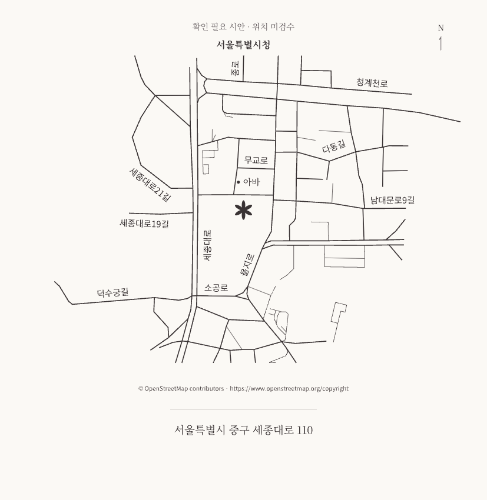
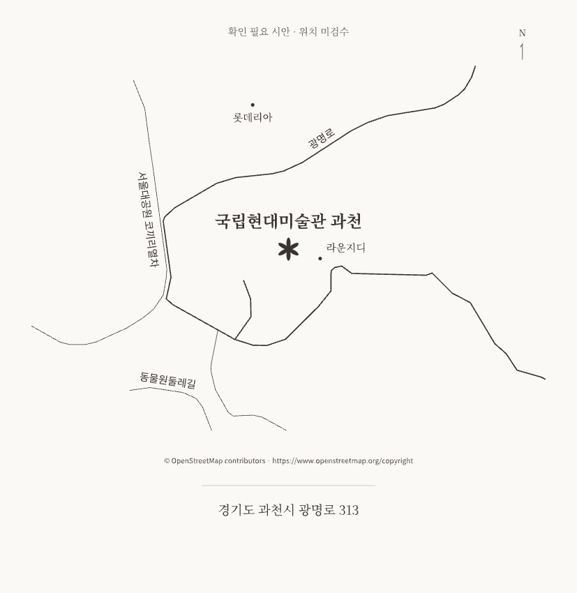

# 실제 주소 10곳의 위치 식별과 출력 평가

2026년 11월 20일, 주택 단지·도심 교차로·외곽 진입로의 공공 방문 장소를 평가했다. 기관이 안내하는 주소와 OpenStreetMap(OSM)의 도로명·건물번호 태그를 비교했다. **찾으려는 기관 또는 단지 전체가 유일한 주소 후보인 곳은 2곳, 여러 후보 중 하나인 곳은 4곳이었다.** 3곳은 주소 태그로 후보를 찾지 못했고, 경복궁은 서로 다른 세부 건물만 반환됐다. 총 10곳에서 실물 정문과 주차 진입구는 미검수다.

별도 시험으로 조사자가 공개 기관 자료를 보고 OSM의 목표 객체 하나씩을 식별했다. 이 입력 10개로 실제 앱의 배치·출력 모듈을 실행해 ZIP 10개를 생성하고 다시 열어 검사했다. 주소 검색 실패율과 출력 성공률을 따로 기록한 이유는, 사람이 먼저 목표 지점을 골라 주면 주소 검색이 실패한 장소에서도 파일을 만들 수 있기 때문이다.

## 주소별 기록

후보 수는 한국 추출본 전체에서 도로명과 건물번호가 정확히 일치한 객체 수다. 도로 수는 선택된 시설 경계의 **외접 사각형 중심** 350 m 이내에 정점이 있는 차도 way 수다. 원천 way의 분할 때문에 길 하나가 여러 개로 집계될 수 있다. ZIP 생성 시간에는 로컬 글꼴 로드, PNG·PDF·SVG 생성과 10개 파일 압축을 포함한다.

| 장소와 기관 주소 | 주소 후보 | 도로 수 | 표시한 도로명 / 시설명 | ZIP 생성 | 검수할 내용 |
| --- | ---: | ---: | ---: | ---: | --- |
| 다산신도시 자연앤푸르지오 · 다산중앙로82번안길 74 | 0 | 80 | 5 / 1 | 471 ms | 단지명으로 경계 확인. 방문할 동과 진입구 추가 확인. [GH](https://apply.gh.or.kr/co/cop/selectAstMngListPopup.do) |
| 금교초등학교 · 미금로 194 | 0 | 89 | 6 / 0 | 310 ms | 학교 부지로 위치 대조. 교문과 정류장의 식별 보완. [학교 안내](https://kumkyo-e.goegn.kr/kumkyo-e/lm/location/locationMapView.do?mi=10613) |
| 서울특별시청 · 세종대로 110 | 4 | 96 | 11 / 1 | 366 ms | 시청 건물과 도서관·업장 등 후보를 구별. 실제 출입구 선택 필요. [서울특별시](https://www.seoul.go.kr/seoul/seoul.do) |
| 서울시립미술관 서소문본관 · 덕수궁길 61 | 1 | 66 | 11 / 2 | 359 ms | 일치한 미술관 경계와 현관 구분. 공식 방문 안내에서 접근로를 재확인. [미술관 안내](https://sema.seoul.go.kr/kr/visit/seosomun) |
| 세종문화회관 · 세종대로 175 | 6 | 114 | 14 / 1 | 356 ms | 대극장·체임버홀 등 세부 객체가 같은 주소를 사용. 실제 공연장 필요. [세종문화회관](https://www.sejongpac.or.kr/portal/main/contents.do?menuNo=200352) |
| 서울역사박물관 · 새문안로 55 | 2 | 46 | 9 / 3 | 408 ms | 박물관과 흥화문의 주소가 일치. 주차 안내와 본관 접근로 분리. [박물관 안내](https://museum.seoul.go.kr/chd/watch/watchGuideMap.jsp) |
| 국립중앙박물관 · 서빙고로 137 | 8 | 33 | 1 / 5 | 416 ms | 공연장·식당 등과 본관 구분. 350 m 도로 후보에 서빙고로가 없어 범위 재설정 필요. [박물관 안내](https://www.museum.go.kr/MUSEUM/contents/M0106030000.do?menuId=car-map) |
| 경복궁 · 사직로 161 | 2 | 26 | 7 / 2 | 348 ms | 주소 일치 결과는 광화문과 근정전. 궁 전체 경계 중심의 350 m 자료에 사직로가 없다. 실제 방문할 문과 도착 수단 지정 필요. [궁능유적본부](https://royal.khs.go.kr/ENG/contents/R707000000.do) |
| 국립수목원 · 광릉수목원로 509 | 0 | 10 | 0 / 0 | 265 ms | 수목원 넓은 경계 안의 중심에는 이름이 붙은 차도와 시설 후보가 없다. 정문 근거와 진입도로를 확보한 뒤 제작해야 한다. [국립수목원](https://kna.forest.go.kr/kfsweb/kfi/kfs/mbm/selectEmployeeList.do?category1=1400837&mn=UKNA_06_03_02) |
| 국립현대미술관 과천 · 광명로 313 | 1 | 10 | 3 / 2 | 350 ms | 광명로를 표시했다. 대공원역에서 도보·셔틀 등 접근 방식이 달라 최종 경로를 별도 선택. [미술관 안내](https://www.mmca.go.kr/visitingInfo/gwacheonInfo.do) |

다산74 앱 기본 예시는 같은 단지의 **면적중심**과 220 m 반경을 사용한다. 이 표의 350 m 수치는 열 곳을 같은 조건에서 비교한 별도 측정이다. [다산74 취득 기록](sources.md)

## 도심과 외곽 시안

서울시청 시안에서는 세종대로·을지로·소공로를 서로 구별할 수 있다. 출처의 작은 업장까지 시설 후보가 되어 주변의 대표 시설 선정에는 보완이 필요하다. 과천 미술관 시안에서는 광명로와 동물원둘레길을 읽을 수 있다. 코끼리열차 구간의 표시 의미와 보행자 통행 가능 여부는 확인 후 최종본에 반영해야 한다. 두 시안의 꽃은 건물 경계의 대표점을 가리킨다.

| 도심 교차로 · 서울특별시청 | 외곽 진입로 · 국립현대미술관 과천 |
| --- | --- |
|  |  |

## 측정 범위와 재현

- 2026-11-18 21:21:02 UTC 시점의 한국 전체 OSM 공개 추출본 한 개를 사용했다. 11월 20일 09:37:07 KST에 수신한 PBF의 SHA-256은 `dcdfd8b001344ad5564682c2a1e393d327620f296f3412b2156dd4e17cc61bb8`이다. 추출본과 선별한 위치·도로 자료는 © OpenStreetMap contributors, ODbL 1.0이다. [Geofabrik 파일 목록](https://download.geofabrik.de/asia/south-korea.html) · [OSM 저작권](https://www.openstreetmap.org/copyright)
- 원천 시설을 수동 식별한 뒤 앱의 TypeScript 배치 시간을 Node 22에서 장소별 1회 측정했다. 0.20~3.29 ms였다. macOS Chrome 157.0.8103.79의 로컬 웹 출처에서 같은 10개 입력으로 최종 ZIP을 생성했다. 파일별 SHA-256, ZIP 구성원 10개, 전체·지도만 PNG 크기 및 600 dpi 헤더, SVG 본문 OSM 출처, PDF 페이지 및 비트맵 미포함을 검사했다. 단일 실행이며 글꼴 캐시의 영향을 받는다. 공식 Pages 실시간 조회 시간과 사람이 편집하는 시간은 미측정이다. [실행 기록과 후보 ID](../data/evaluation/results.json)
- 도로 교차 선분과 글자 근사 경계의 계산에서 경고는 0건이었다. 도심·외곽 시안 2건을 육안으로 추가 점검했다. 색인·범위가 달라지는 실시간 Overpass와 현장 위치 검수 결과는 별도로 기록해야 한다.
- 나머지 자료는 기관의 주소와 OSM 시설명을 대조해 고른 시험 객체 ID를 포함한다. 넓은 경계의 중심을 방문 장소로 자동 승인하는 기능에 사용하면 안 된다. [주소·시설 목록](../data/evaluation/addresses.json)

재실행에는 Python 3와 pyosmium 4.3.2, 프로젝트의 Node 의존성, 데스크톱 Chrome이 필요하다. 결과는 지정한 출력 폴더에 저장한다. 같은 자료를 내려받은 뒤 프로젝트 루트에서 실행한다.

```sh
python3 data/evaluation/assess.py south-korea-261118.osm.pbf /tmp/wedding-address-eval
node --import tsx data/evaluation/check-layout.ts /tmp/wedding-address-eval
node data/evaluation/browser-export.mjs /tmp/wedding-address-eval
```
